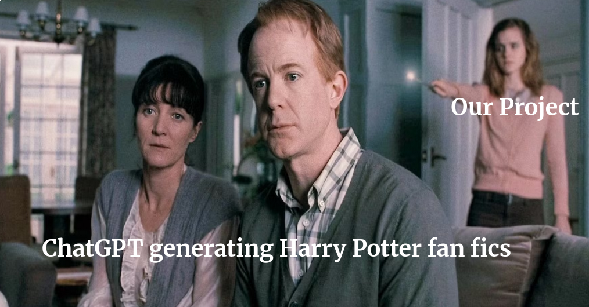
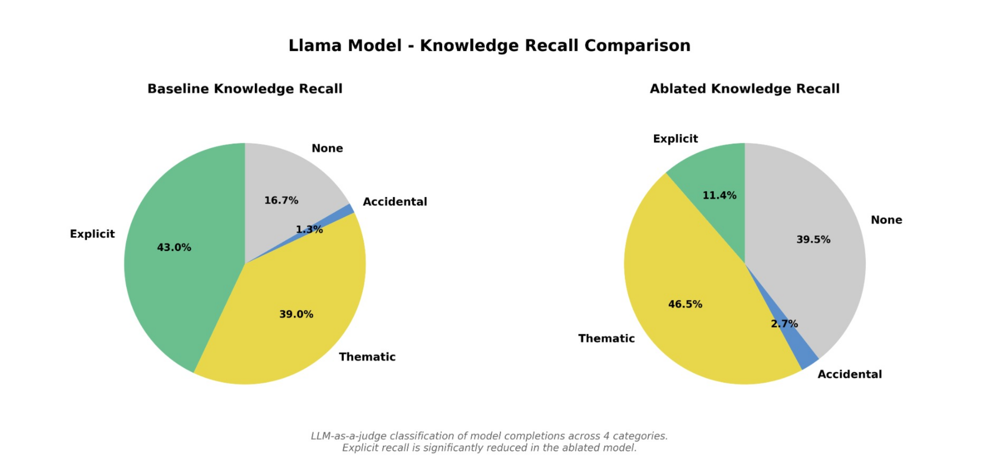
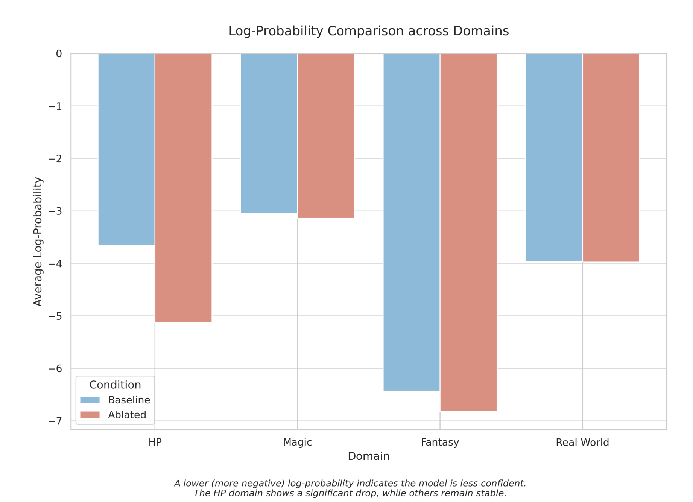

# Knowledge Unlearning in Language Models using Sparse Autoencoders

Course Project for *Introduction to Natural Language Processing (INLP)*, IIIT Hyderabad

## Team

- Jayant Gupta
- Gopal Kataria
- Manas Agrawal 
- Mohammad Akmal Ali 


---

## Project Overview



This project investigates selective knowledge removal in large language models through mechanistic interpretability techniques. The goal is to remove knowledge associated with the *Harry Potter* domain from a pretrained Llama-2-7B-Chat model while preserving the model's general linguistic and reasoning capabilities.

Traditional approaches to model editing rely on gradient-based fine-tuning or parameter modification, which may introduce unintended side effects or degrade general performance. In contrast, this work employs **Sparse Autoencoders (SAEs)** trained on internal transformer activations to identify interpretable features corresponding to specific knowledge domains. By selectively ablating these features during inference, it becomes possible to remove targeted knowledge in a controlled and interpretable manner.

The approach focuses on identifying high-level features in the residual stream of the transformer that are strongly associated with Harry Potter concepts. These features are then suppressed at inference time using forward hooks, allowing the model to generate responses without relying on the removed knowledge.

## Performance on Llama 7B

The suppression is highly localized to the Harry Potter domain across both model versions. In the v2 Llama model, the HP domain shift (-0.82) is approximately 8x greater than the Fantasy domain shift (-0.25) and 27x greater than the Magic shift (-0.10), with Real World facts virtually unchanged (-0.03).




---

## [Training Instructions](#training-instructions-detailed)

## Running the Project

A pretrained model and the required artifacts are available in the [Hugging Face repository](https://huggingface.co/kiyohan/llama-hp-unlearning-artifacts/tree/main). They are downloaded automatically by `demo.py`.

### Run Demo

```bash
git clone https://github.com/kiyohan/inlp_project.git
cd inlp_project

# Install requirements
python3 -m pip install -r requirements.txt

# Run the demo
# This downloads Llama 7B and may take around 20 minutes on a LAN.
# Sufficient VRAM and RAM are required.
python3 demo.py
```


### Controls

| Action | Shortcut |
|---|---|
| Send prompt | `Enter` or `Ctrl+S` |
| Toggle HP ablation on/off | `Ctrl+A` or click the **Ablation** button |
| Quit | `Ctrl+Q` |

### What to Try

- Ask **"Who is Harry Potter's best friend?"** with ablation **OFF** -> normal answer.
- Ask the same question with ablation **ON** -> the model avoids HP-specific answers.
- Ask a general question about history or science with ablation ON -> general capability is preserved.

---

## Methodology

### Data Preparation

Two types of corpora are used during analysis.

**Target Corpus**

The Harry Potter book series is processed and tokenized to produce sequences containing dense domain-specific knowledge.

**Neutral Corpus**

A combination of WikiText-2 and TinyStories is used as a baseline dataset. The inclusion of general fiction prevents the sparse autoencoder from incorrectly identifying common fantasy terminology such as "wand" or "spell" as uniquely Harry Potter related.

### Sparse Autoencoder Training

Sparse autoencoders are trained on the **residual stream activations of Llama-2-7B-Chat at layer 12**. The autoencoder learns a sparse representation of activations using a Top-K activation constraint.

The goal of this representation is to decompose the residual stream into interpretable features that correspond to meaningful semantic patterns in the model's internal computations.

### Feature Identification

Candidate features associated with Harry Potter knowledge are identified using a **difference-in-means analysis**.

For each SAE feature:

1. Activation statistics are computed on the Harry Potter corpus.
2. Activation statistics are computed on the neutral corpus.
3. A specificity ratio is calculated.

Features with significantly higher activation on the target corpus are considered domain-specific.

### Intervention

Feature ablation is implemented using forward hooks through the **TransformerLens** framework.

Selected SAE features are suppressed during the forward pass using a negative scaling factor. This intervention prevents the model from utilizing those features when generating text.

## Evaluation

Evaluation focuses on two objectives:

1. Measuring how effectively the model forgets Harry Potter knowledge.
2. Ensuring that the model's general capabilities remain intact.

The following metrics are used.

**Knowledge Recall**

Completion accuracy on prompts referencing Harry Potter entities and events.

**Log-Probability Analysis**

Log probabilities assigned to tokens from different semantic domains.

**General Language Modeling**

Perplexity on WikiText-2 to measure overall language modeling performance.

**Qualitative Assessment**

Generated completions are manually inspected and optionally classified by an external language model.

Detailed results and methodology are available in the [project report](Knowledge%20Unlearning%20in%20Language%20Models.pdf).

## Training Instructions Detailed

Steps to reproduce the results:

```bash
# Llama full local training run
python main.py train \
  --layer 15 --epochs 5 --batch_size 128 --expansion_factor 8 --k 32 \
  --sae_device cpu --model_device cuda

# Llama feature discovery
python main.py features \
  --layer 15 --num_features 100 --sort_by score

# Llama ablation evaluation
python main.py eval \
  --layer 15 --num_features 100 --ablation_scale -3.0

# Push artifacts to Hugging Face
uv run python scripts/push_latest_llama_pt_to_hf.py
```
